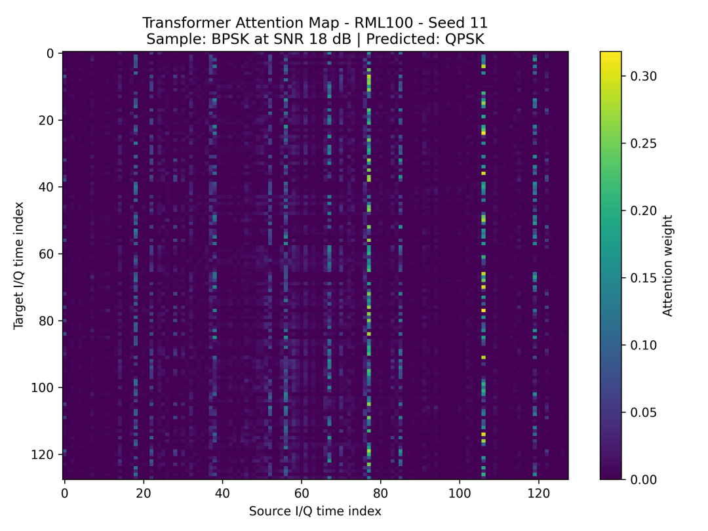
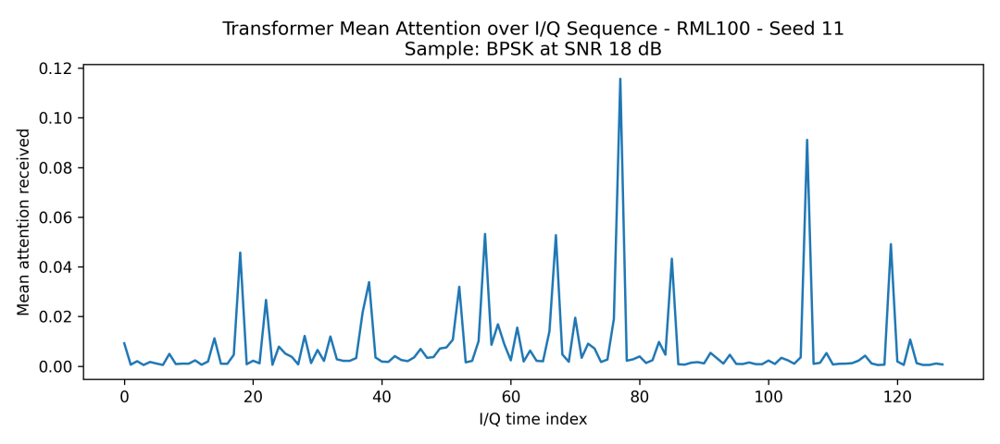
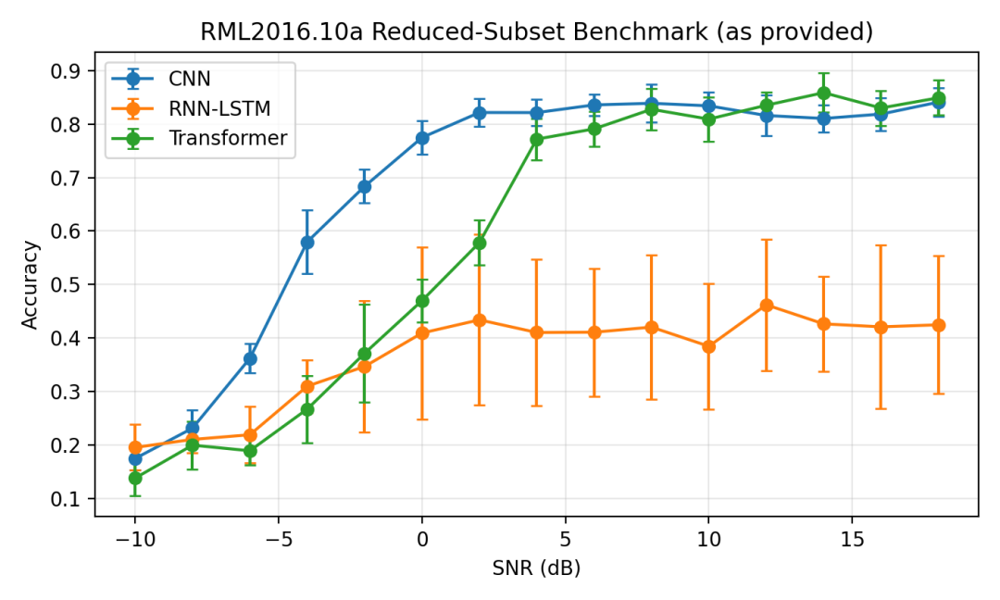
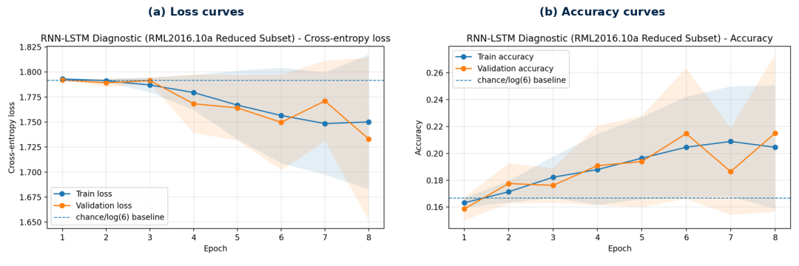
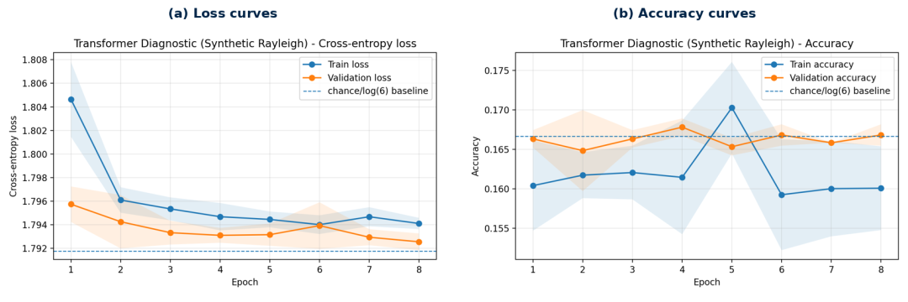
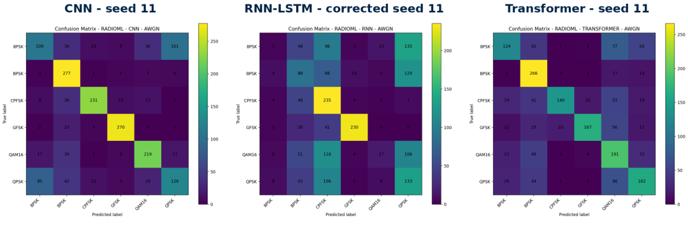

# When AI begins to "listen" to radio waves: a deep learning battle over modulation recognition [with Python code]

1. An underestimated battlefield: the cat-and-mouse game in the electromagnetic spectrum
In modern warfare, victory often hinges on radio waves.
When a drone transmits reconnaissance images back to ground stations, when a frequency hopping radio switches frequencies in battle, and when a radar silently locks onto targets from hundreds of kilometers away—all these actions are continuously emitting electromagnetic signals that have been "modulated" in some way. And whether it can automatically identify the modulation used in intercepted unknown signals, such as BPSK, QPSK, or 16QAM, is known as automatic modulation recognition (AMR) in the field of electronic warfare.
It sounds technical. But you could imagine it as a kind of ability: amidst a noisy conversation, not just hearing what someone is saying but directly identifying whether they are speaking Mandarin, English, Japanese, or Arabic—and this process must be completed within milliseconds, in a real environment filled with noise, multipath reflections, and human interference.
This is precisely the problem Abdulrahman Enaad Alonize tackled in his master's thesis at King Saud University in Riyadh in 2026. This time, he went beyond single model optimization and did something rarely done in master's theses: he compared three mainstream deep learning architectures from start to finish under the same standard, and conducted multiple rounds of statistical tests under three different channel conditions.
2. The appearance of the "three contestants"
This study selected three distinct deep models, each with their own high moments in different fields:
CNN (Convolutional Neural Network), a "veteran" in the field of signal processing. Its 1D convolutional kernels are inherently adept at capturing local temporal patterns within I/Q sequences, using three sets of increasingly deeper convolutional blocks (64→128→256 filters) to compress 128 sample points into high-dimensional features.
BiLSTM (Bidirectional Long Short-Term Memory Network), naturally suited for sequence processing. The two-layer bidirectional structure means it scans each I/Q waveform from left to right and from right to left simultaneously, theoretically capable of perceiving long-term dependencies across the entire signal. In the paper, researchers specifically corrected an implementation detail—by explicitly concatenating the forward and backward hidden states at the last layer rather than simply taking the last time step output—a change that significantly impacted performance.
Transformer, a "paradigm-defining" in the field of natural language processing. With two layers of encoders, eight attention heads, and classic Sinusoidal position encoding—structure-wise a direct replication of "Attention Is All You Need" from years past. However, it faces not word vectors but real-number sequences in I/Q dual channels, ultimately compressing the encoder output into a global representation through mean pooling.
The parameter differences among these three models are worth mentioning: CNN around 15M, BiLSTM around 1.3M, and Transformer only about 0.6M—the simplest structure yet with the smallest parameter count.
The experimental design's "hardcore" aspect lies in its multi-dimensional comparison framework. What's valuable about this study is its multi-dimensional comparative framework.
Two-layer datasets. The first layer is a synthetic dataset covering six modulation schemes: BPSK, QPSK, 8PSK, 16QAM, GFSK, and OFDM, with a sequence length of 128 and a signal-to-noise ratio ranging from -10 dB to +20 dB. The second layer is a subset of RadioML 2016.10A—a real-world collected radio frequency signal dataset, recognized as an industry benchmark. Although the data itself is not included in the open-source repository, the paper has conducted rigorous external validation using its RML100 subset (6 classes, -10 to +18 dB).
Three sets of channel conditions. AWGN refers to "white noise additive interference," representing the most basic channel model. Rayleigh fading simulates the multipath effects of signals reflected by buildings in urban environments, while three-tap complex Gaussian taps cause "tailing" in the time domain. Single-tone jamming is one of the most classic countermeasures in electronic warfare—injecting a pure interference tone at the target frequency point directly disrupts the receiver's demodulation capability.
Five rounds of independent repeat experiments. Many deep learning papers only run one round before reporting results. This study set up five different random seeds (7 to 11) for independent training and evaluation, then validated normality with Shapiro-Wilk test and variance homogeneity with Levene test, followed by pairwise t-tests, and finally controlled false positive risk with Holm correction. Each number given is "mean ± standard deviation" plus p-value and Cohen's d effect size.
This data reporting method, to be honest, is not common in deep learning papers in the field of signal processing.
Now, let's talk about the core RML100 real dataset.
CNN achieved an accuracy of 68.2% (±0.3%), Transformer was at 58.3% (±1.4%), and BiLSTM only reached 36.6% (±9.9%). CNN outperformed Transformer by about 10 percentage points, with a p-value far less than 0.001; BiLSTM not only had a significantly lower mean but also experienced an astonishing standard deviation of 9.9% across five rounds of trials—meaning it performed extremely unstable under different initializations. This is almost a disqualifying factor in engineering.
Moving on to synthetic datasets. 
Under pure AWGN conditions, the winner became Transformer. It surpassed both CNN's 46.7% average accuracy and BiLSTM's 25.7% with an overall signal-to-noise ratio (SNR) of 59.8%. Close observation of the SNR curves reveals that Transformer's advantage is particularly pronounced in the high SNR range (above 10 dB): when SNR=20 dB, it reached 88.0%, while CNN only managed 54.8%. This gap indicates that when interference is sufficiently low, Transformer's global attention mechanism indeed captures certain patterns that CNN's local convolutional layers struggle to perceive.
However, once the channel deteriorated—which is precisely what electronic warfare scenarios care about—the situation immediately reversed.
In Rayleigh fading conditions: CNN fell to 27.5%, BiLSTM to 19.8%, and Transformer directly locked at 16.7%. Note what this 16.7% means: the random guess probability for six modulation types is exactly 16.7%. In other words, Transformer completely collapsed in Rayleigh multipath, essentially making random guesses blindly.
Under monosonic interference conditions: CNN maintains a 41.1% line, Transformer drops to 35.6%, and BiLSTM falls to 20.7%. The relative robustness of CNN in the face of interference is evident here: it outperforms Transformer by 5.5 percentage points, which is statistically significant (p=0.019); it's even double that of BiLSTM.

Beyond accuracy alone: looking at the confusion matrix reveals much more than just overall accuracy. Examining the confusion matrix piece by piece reveals several intriguing patterns. On RML100, CNN achieves an accuracy rate of 88.7% for GFSK and 83.2% for CPFSK—both frequency shift keying modulations have a clear "frequency hopping" pattern in the time domain, which the convolutional kernels are particularly sensitive to. However, for QPSK and 8PSK, CNN's accuracy rates drop to 45.9% and 47.0% respectively. Why? Because these phase-shift keying modulations have a natural similarity in their point distribution on the I/Q constellation diagram, and noise smooths out the differences, causing the model to oscillate between them repeatedly.

Three models share a "fatal blind spot": In low SNR regions, the high-order constellation points of 16QAM completely drown in noise, making it nearly impossible to distinguish from QPSK. Under Rayleigh conditions, multipath effects introduce intersymbol interference that makes QPSK, 8PSK, and 16QAM all blend together in the feature space, with their boundaries being irrecoverable within short sequences of 128 points.

Particularly noteworthy is the "confusion spillover" phenomenon under monosonic interference. Under AWGN, the model's confusion usually occurs only within the "family" of modulation types—for example, between phase modulations or between amplitude modulations. But with monosonic interference added, CNN starts occasionally misclassifying BPSK as GFSK, a cross-family confusion pattern indicating that the interference not only raises the noise floor but also introduces narrowband biases that CNN cannot effectively filter out.
6. Why CNNs "Tough"? From a theoretical and intuitive standpoint, many would bet on Transformers. After all, the attention mechanism's global modeling capability has been repeatedly validated in NLP and CV, and it indeed won clean AWGN conditions.
However, in the face of multipath fading and human interference, CNNs' local receptive fields have become structural advantages.
This is not an empty claim. Rayleigh channels essentially add a time-varying multiplicative distortion to the signal—different positions within each frame are "randomly thinned or thickened." Convolutional kernels inherently perform weighted summation over small regions, effectively smoothing adjacent sampling points, which naturally possesses some degree of amplitude fluctuation resistance. In contrast, the self-attention matrix of Transformers becomes dispersed and disorganized when encountering severely distorted inputs due to multipath propagation, with the global representation after mean pooling degenerating into noise.
The downturn of BiLSTM indicates another direction: The gating mechanism of LSTM theoretically allows selective forgetting of noise, but when the input length is only 128 sample points, the bidirectional two-layer design may overcomplicate the problem. There is no long-range semantic dependency across sentences as in NLP tasks; forcing RNNs to "remember" instead introduces unstable gradient paths. The standard deviation of 9.9% after five rounds of experiments is evidence—BiLSTM is sensitive to initialization to the point where it is difficult to engineer.
Adding a word about parameter efficiency. Transformers have only one-fifth of the total parameters as CNNs, yet they surpass CNNs in clean AWGN conditions. If we only consider low complexity, high SNR applications—such as indoor short-range communication or satellite uplink/downlink—using Transformers to replace CNNs is indeed a worthwhile consideration.
7. From the lab to the battlefield: How far is there still to go? This study provides a clear and data-supported conclusion: In electronic warfare scenarios, CNNs remain the most robust foundational architecture for automatic modulation recognition.
However, it also honestly labels its boundaries.
A core limitation is the length of the sequence. The 128 sample points are too short for the actual deployment of cognitive radios. Under this length, the subcarrier structure of OFDM is almost impossible to perceive, and the difference in constellation of high-order QAM is also compressed to the vanishingly small. If the sequence were extended to 512 or even 1024, the performance of Transformer might significantly change—after all, the advantage of self-attention lies precisely in long-range modeling.
Moreover, the distance between synthetic datasets and real electromagnetic environments must be acknowledged. The Rayleigh model is a simplified version of three taps; there is only one interfered tone with a fixed frequency offset; there are no dynamic switching signal streams or open set recognition problems involving unknown modulation types. The paper itself is very clear in the README: this study does not claim to have combat-level electronic warfare verification capabilities—a valuable academic honesty.
However, the introduction of statistical tests is worth emulating by all those doing comparative experiments in deep learning. When most papers still report results with the highest accuracy, five independent seeds taking the mean, running paired t-tests, and performing Holm correction, they achieve a leap in conclusion reliability at almost zero cost. This is also the least "master's" aspect of this master's thesis.
Eighth, looking back at the underlying logic of the entire research, it answers a simple but important question: under the premise of unlimited computational power and data, which architecture should be invested in the development of AMR systems for real world?
The answer is contextual. If your channel environment is controllable and the SNR is guaranteed, Transformer takes the best metrics with the smallest model size, making it a cost-effective choice. But if you face multipath reflections, human interference, and unpredictable electromagnetic noise - CNN remains the most reliable option. As for BiLSTM, its sequence modeling advantage has not been realized under the short-term scenario of 128 I/Q samples.
The future? Will Transformer be able to turn the tide after its initial struggles with signal lengths spanning from 128 to 1024 and beyond? Will ensemble learning of three models outperform any single model? Can self-supervised pretraining allow AMR to enjoy the "big model dividend" like NLP? These are the clear next steps laid out before us.
The value of this paper lies precisely in setting up a clean, replicable, and comparable evaluation benchmark for researchers in this direction. The rest is up to their imagination.
Reference Paper: Alonize, A. E. (2026). Automatic Modulation Recognition for Wireless Communications in the Defense Systems Against Electronic Warfare and Cyber Attacks. M.Sc. Thesis, King Faisal University.
📌 Key Conclusion Quick Overview
Strongest Model
Accuracy
Key Findings
Pure AWGN (Synthetic)
Transformer
59.8%
Attentional Advantage Significant at High SNR
Rayleigh Multipath (Synthetic)
CNN
27.5%
Transformer Crashes to Random Level
Single-tone Interference (Synthetic)
CNN
41.1%
CNN's Resistance to Interference About 5.5pp
RML100 Real Signal
CNN
68.2%
Higher Than Transformer by 10pp
Three Key Numbers:
CNN achieves 68.2% (±0.3%) on RML100, with extremely low variance, demonstrating engineering reliability.
Transformer exceeds 88.0% under 20 dB SNR synthetic AWGN, but only 16.7% (approximately random guess) under Rayleigh noise.
BiLSTM's standard deviation in five rounds of trials is 9.9%, indicating severe initialization instability.

## Images

<!-- PAYMENT_BLOCK -->

## Get this dataset

- Payment link (Stripe): [Buy now](https://buy.stripe.com/3cs8yP7sY87d0vu9AB)
- Payment QR code: 

<!-- /PAYMENT_BLOCK -->
